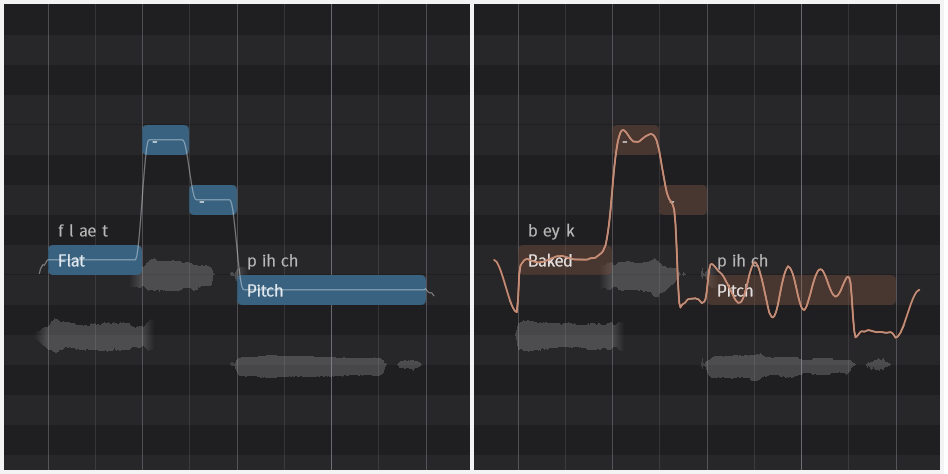

# SynthV2 Scripts

  

| Script | Requires | What it does |
|---|---|---|
| **FlatPitch** | 2.1.0+ | Flattens pitch to each note's pitch, with smooth note-to-note transitions |
| **BakedPitch** | 2.1.1+ | Freezes the AI-generated pitch of selected notes into editable pitch curves |

## FlatPitch

Replaces the pitch of selected notes with flat lines at their note pitch
(removes AI vibrato, drift and overshoots).

Dialog options:

- **Transition duration (seconds)** — glide length between notes, split evenly across
  the boundary: half on the previous note's tail, half on the next note's head.
  Default `0.070`; `0` disables glides (instant steps).
- **Keep existing curves / Keep existing points** — preserve them; only the uncovered
  parts of the notes are flattened.

## BakedPitch

Samples the current AI pitch of the selected notes and writes it as pitch curves.
After baking, the pitch stays exactly as heard — AI regeneration no longer changes it.
Unvoiced notes (`sil`, `cl`, `vf`, `br`) are bridged with smooth glides.
  
## Disclaimer

These scripts were developed using an AI assistant (Qwen).
As with any project created in the vibe coding paradigm, inaccuracies or errors
characteristic of automatic code generation may be present.